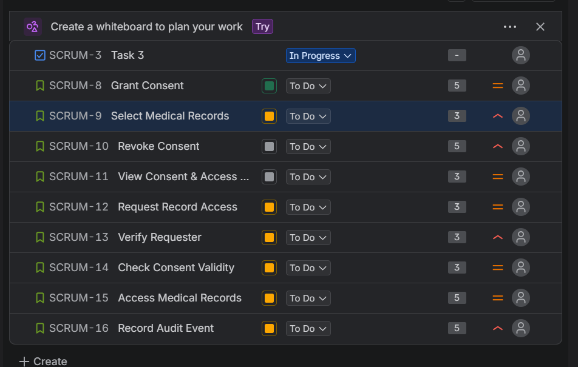
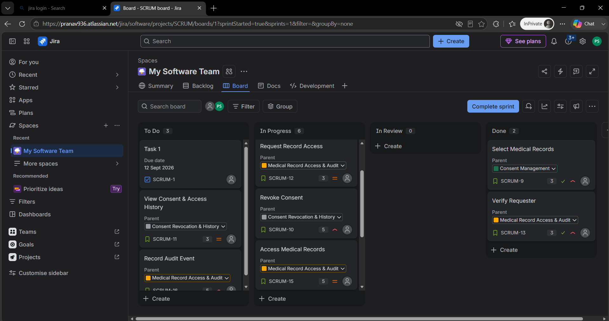
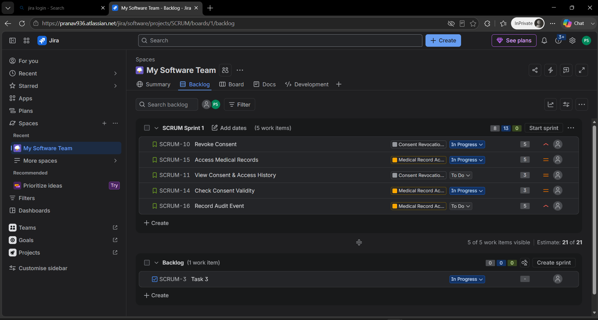
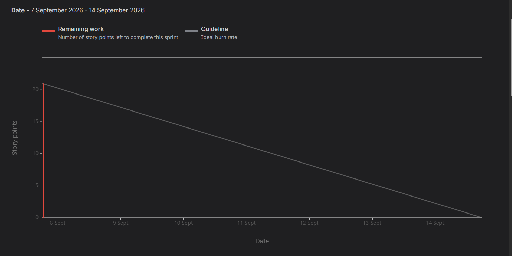

# Lab 2 – Jira Hands-on: Agile Backlog Creation & Sprint Simulation

## Project
**Patient Health Record Consent Management System**

This repository contains the deliverables for **Lab 2: Agile Backlog Creation & Sprint Simulation in Jira**.

## Objective
Use Jira to convert functional requirements into Agile backlog items, prioritize and estimate them, simulate Scrum sprints, and analyze progress using a Burndown Chart.

## Agile Backlog

### Epic 1 – Consent Management
Enable patients to grant time-bounded access permissions to selected medical records for verified clinic doctors.

| User Story | Priority | Story Points |
|---|---|---:|
| Grant Consent | High | 5 |
| Select Medical Records | High | 3 |

### Epic 2 – Consent Revocation & History
Enable patients to revoke previously granted consent and view the history of consent grants, revocations, and medical record access events.

| User Story | Priority | Story Points |
|---|---|---:|
| Revoke Consent | High | 5 |
| View Consent & Access History | Medium | 3 |

### Epic 3 – Medical Record Access & Audit
Enable verified clinic administrators and doctors to request, verify, validate and access patient medical records while maintaining a secure audit trail.

| User Story | Priority | Story Points |
|---|---|---:|
| Request Record Access | Medium | 3 |
| Verify Requester | High | 3 |
| Check Consent Validity | High | 3 |
| Access Medical Records | High | 5 |
| Record Audit Event | High | 5 |

**Total backlog estimate: 35 story points**

## Jira Evidence

### 1. Story Point Assignments


### 2. Active Sprint Board


### 3. Sprint Planning


### 4. Burndown Chart


The simulated sprint shown in the Burndown Chart started with **21 story points** and reached **0 remaining points**.

## Reflection

### 1. Did your estimations reflect the actual effort?
Yes, the estimates were reasonably consistent with the simulated effort. The backlog used Fibonacci values of 3 and 5 points, and the second sprint successfully completed all 21 planned story points. Since this was a simulation, the result should not be treated as a real-world velocity measurement.

### 2. Was your backlog well-prioritized?
Yes. High-priority stories were placed ahead of medium-priority stories because they directly support core consent and security functions. Grant Consent, Revoke Consent, Select Medical Records, Verify Requester, Check Consent Validity, Access Medical Records, and Record Audit Event were treated as high priority.

### 3. How did your simulated sprint align with your plan?
The sprint followed the planned Scrum workflow: work was selected, the sprint was started for one week, and stories were progressed through To Do, In Progress and Done. The second sprint completed all five carried-over stories, totaling 21 story points.

### 4. What insights did the burndown chart give about your team’s capacity?
The chart showed that the team was able to complete the full 21-point sprint commitment. It also showed a steep drop because several items were recorded as completed together. In a real sprint, more frequent daily updates would provide a more realistic view of progress and team capacity.

## Requirements Covered

The backlog is based on the Lab 1 requirements covering:
- Granting time-bounded consent
- Revoking consent
- Selecting specific medical records
- Requesting record access
- Viewing consent and access history
- Maintaining an append-only audit trail
- Performance expectations for consent operations

## Repository Contents

```text
jira-lab2-patient-consent/
├── README.md
├── Lab_2_Jira_Deliverables_Patient_Consent.pdf
├── Lab_2_Jira_Deliverables_Patient_Consent.docx
└── screenshots/
    ├── story-points.png
    ├── active-sprint.png
    ├── sprint-planning.png
    └── burndown-chart.png
```

## Note
The screenshots are Jira evidence from the simulated Scrum work. The PDF and DOCX provide the consolidated lab submission and reflection answers.
